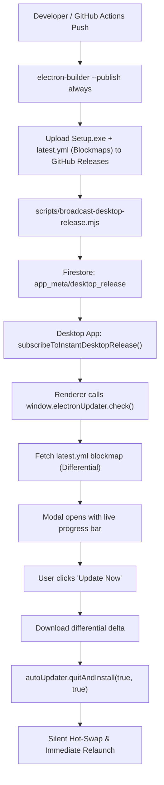

# Desktop Self-Updating App & Firebase Sync Architecture

- **Architecture Standard**: Mandatory Implementation Blueprint
- **Core Components**: Electron + `electron-updater` + Firebase Firestore + GitHub Releases
- **Target Repository**: [https://github.com/yorren005/Y-Master-Editor](https://github.com/yorren005/Y-Master-Editor)

---

## 1. Differential Update Pipeline (`electron-updater`)

---

## 2. Key Files & Configuration Map

| File Path | Purpose |
| :--- | :--- |
| `package.json` | `electron-builder` build configuration, GitHub publish provider, NSIS one-click flags |
| `electron/auto-updater.cjs` | Main process autoUpdater pipeline with silent hot-swap and relaunch |
| `electron/preload.cjs` | ContextBridge exposure of `window.electronUpdater` and `onDesktopRelease` |
| `src/services/DesktopRealtimeTrigger.js` | Real-time Firestore snapshot listener triggering zero-delay updates |
| `scripts/broadcast-desktop-release.mjs` | Automated release broadcaster updating Firebase metadata |
| `.github/workflows/desktop-release.yml` | GitHub Actions CI/CD release workflow |
| `firestore.rules` | Hardened Firestore rules for Nicknames, Users, Telemetry, and App Meta |
